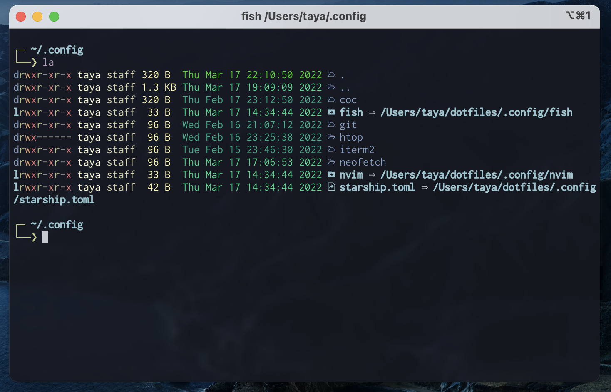

dotfiles
========


This repository is my dotfiles.

### Neovim
Based on [LazyVim](https://www.lazyvim.org/). The plugin manager is lazy.nvim.
- tokyonight: color scheme
- Telescope: fuzzy finder (LazyVim extra `editor.telescope`)
- Plugin versions are pinned in `lazy-lock.json`.
- Personal settings live in `lua/config/` (options, keymaps, autocmds) and `lua/plugins/`.

### fish
- starship: for prompt on terminal.
- Fonts
    - hack nerd font
    - ricty for powerline

### tmux
- prefix is `Ctrl+t`.
- Mouse is on. In Ghostty, hold `Shift` to select text natively.
- Copy mode uses vi keys (`v` to select, `y` to copy via `pbcopy`). Dragging with the mouse also copies.
- Inactive panes are shaded.

### Others
- Ghostty: terminal emulator (theme: TokyoNight Moon, matches Neovim's tokyonight). Linked to `~/Library/Application Support/com.mitchellh.ghostty/config`.
- herdr: terminal workspace manager. prefix is `Ctrl+t`; the sidebar toggles with `Ctrl+t b` and hides completely when collapsed.
- lsd: Luxury ls command

Files:
-------------
    .
    ├── .Rprofile
    ├── .config
    │   ├── fish
    │   ├── ghostty
    │   ├── herdr
    │   ├── nvim
    │   └── starship.toml
    ├── .gitignore
    ├── .latexmkrc
    ├── .tmux.conf
    ├── .zshrc
    ├── README.md
    ├── brew
    │   └── brewlist.txt
    └── shellscript
        ├── cafd.sh
        ├── ide
        └── install_dotfiles.sh

Usage:
-------------
Symlink each file and folder with the following commands:
```bash
git clone https://github.com/tayatoshi/dotfiles.git
cd dotfiles/shellscript
chmod +x install_dotfiles.sh
./install_dotfiles.sh
```

The script works from wherever the repository is cloned.
If a real file or directory already exists at a target path, it is moved to `<path>.bak` before the link is created.

`.zshrc` and `.latexmkrc` are not linked by the script. Link them manually if needed.

Note:
-------------
I have not yet set up automatic installation of packages in Homebrew.
